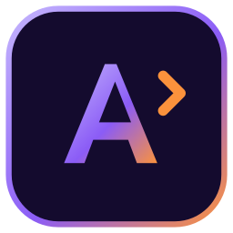

# ALX Language Support

<p align="center">
  
</p>

**The home of [ALX](https://real-devalex.github.io/alx/), a beginner-first programming language for making games.**
Colours, snippets, smart help while you type, a one-click Run button and a purple theme made for it.

---

## What you get

| | |
| --- | --- |
| **Syntax colours** | Keywords, strings with `{interpolation}`, numbers, classes, function calls, built-ins like `lerp` and `Vec2` |
| **Run button** | Press the play button, the status bar button, or `Ctrl+Alt+R`. Output appears in the **ALX Output** panel |
| **Smart completions** | Type `ran` and get `random` and `randomInt`. Type `hero.` and see `update`, `position`, `velocity`. Your own functions, classes and variables show up too |
| **Hover help** | Point at `clamp`, `Entity` or `if` and a short explanation appears |
| **Signature help** | Type `lerp(` and see which argument you are on |
| **Outline** | Press `Ctrl+Shift+O` to jump between your classes and functions |
| **Snippets** | `fn`, `class`, `classx`, `for`, `ifchain`, `vec`, `entity`, `gameloop`, `dice` and more |
| **ALX Night theme** | A deep purple colour theme with orange accents, made to match the ALX docs |
| **Auto indent and comments** | Press Enter after `{` and the next line indents. Press Enter in a `//` comment and it continues |

## Get started

1. [Install ALX](https://real-devalex.github.io/alx/learn/install/) so the `alx` command works.
2. Install this extension.
3. Create `hello.alx` and type `hello`, then press `Tab`.
4. Press the play button at the top right.

```alx
// hello.alx
print("Hello, ALEXION!")

hero = new Entity("Hero", 0, 0)
hero.velocity = new Vec2(4, 3)
hero.update(1)
print("The hero is at {hero.position.toString()}")
```

## Snippets

Type the short word and press `Tab`.

| Type | You get |
| --- | --- |
| `hello` | A print line |
| `fn` `afun` `lambda` | A function, a short function, a lambda |
| `class` `classx` | A class, a class that extends another |
| `if` `ifelse` `ifchain` | Decisions |
| `for` `while` | Loops |
| `arr` `map` | An array, a map |
| `vec` `entity` | A `Vec2`, a moving `Entity` |
| `gameloop` | A small game loop |
| `dice` | A dice roll |

## Commands

Open the Command Palette (`Ctrl+Shift+P`) and type `ALX`.

- **ALX: Run File**
- **ALX: Show Installed Version**
- **ALX: Open Documentation**

## Settings

| Setting | What it does |
| --- | --- |
| `alx.executablePath` | Where the `alx` program is. Leave it as `alx` if it is on your PATH |
| `alx.showStatusBar` | Show or hide the Run button in the status bar |

## Colours and the theme

The colours work with any theme. To get the purple look, open the Command Palette, choose **Preferences: Color Theme** and pick **ALX Night**.

## Something not working?

- **"I could not find the alx program"**: install ALX and open a new terminal, or set `alx.executablePath`.
- **No colours**: check the bottom right says **ALX**. If it says Plain Text, click it and choose ALX.
- Report a problem: [github.com/Real-devalex/alx/issues](https://github.com/Real-devalex/alx/issues).

## Coming next

Friendly error messages, a Language Server with live error underlines, and a step-by-step debugger. See the [roadmap](https://real-devalex.github.io/alx/engine/roadmap/).

---

Made by [Alexion Studios](https://alexion-studios-portfolio.vercel.app). Copyright 2026 Alexion Studios. All rights reserved.
